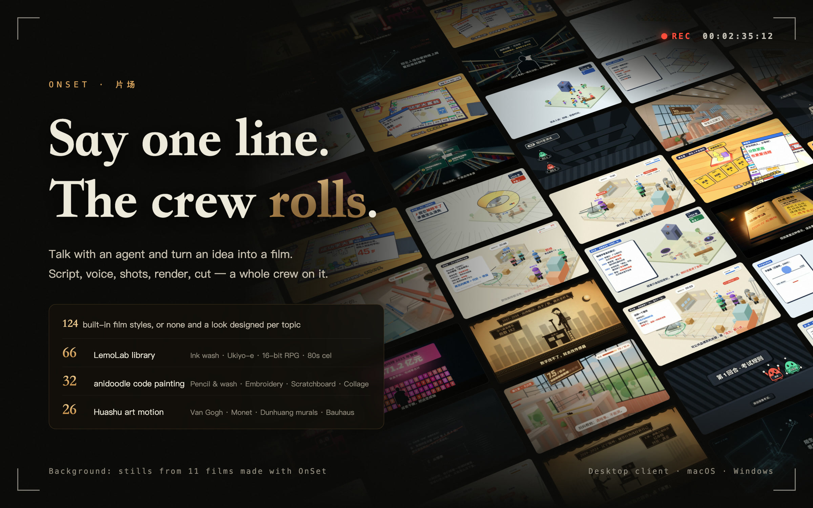

<p align="right"><a href="./README.md">简体中文</a> | English</p>

<p align="center"></p>

# OnSet

**Talk with an agent, and turn an idea into a video.**

OnSet (片场, "film set") is a desktop client for macOS and Windows. You say what you want in a chat, and an agent works like a film crew: it writes the script, records the voice-over, times the subtitles, plans the shots, renders the motion-graphics scenes in parallel, cuts them together, makes covers and gets the film ready to publish, stopping to ask you whenever a decision is yours. Hand it an article or a narration script if you have one, or start from nothing. It can also make beat-synced films with no voice-over, where the picture follows the music, in vertical or landscape.

An AI orchestrator of your choice does the production inside the client: Codex, Claude Code, Qoder, CodeBuddy, or OpenCode. You tell it what you want in the chat and make the calls at each checkpoint. Project prompts, publishing templates, and skills ship inside the client. The HyperFrames skills are installed into the project at a pinned official release, so a project is self-contained: copy the directory to another machine with the client installed and carry on.

## Install

GitHub Releases provides these installers, with `checksums.txt` for verification:

- macOS: download `OnSet-<version>-arm64.dmg` for Apple Silicon or `OnSet-<version>-x64.dmg` for Intel, then drag OnSet into Applications.
- Windows x64 (experimental): run `OnSet-<version>-windows-x64-setup.exe`. The Windows port is incomplete; tool downloads and parts of the production workflow still need adaptation. The installer is unsigned.

The macOS build is unsigned. The first time, **right-click (or Control-click) OnSet in Applications → Open**, then click Open in the dialog. After that it opens normally. If a double-click is blocked, you can also go to System Settings → Privacy & Security and click "Open Anyway".

Requirements:

- macOS (Apple Silicon or Intel) or Windows x64
- At least one logged-in CLI among Codex, Claude Code, Qoder, CodeBuddy, and OpenCode
- Voice defaults to the local Breeze TTS 2 on Apple Silicon (offline, no account; the setup page downloads its ~4.6 GB model once). Intel Macs default to MiniMax, which needs an account. Either can be changed in Settings

You do not need to install Node.js, Python, FFmpeg, Git, or Homebrew. The Chromium used for rendering and the runtime both ship with the client. Everything else is downloaded with one click on the first launch, from "Assemble your crew" on the home page. It comes in four groups (picture, editing, voice, subtitles), takes a few minutes, and is shared by every project afterwards. An existing FFmpeg on the machine is used as is.

If GitHub is slow, enter a proxy under "Network" on the setup page; a retry resumes where it stopped. Multi-GB resources such as the beat-analysis environment and the film-style library are listed under "Might need later" and can be installed when you need them.

Nothing else in the client downloads from the network. If creating a project, switching styles, or rendering finds something missing, it points you back to the setup page instead of stalling halfway.

The client reads `PATH` from your login shell even when launched from Finder or the Dock, so orchestrators installed through Homebrew, asdf, or nvm need no extra setup.

## Create a project

On the home page, type what you want to make or drop an article into the input box. This creates a project and starts production. You can also open an existing project from File → Open Project Folder…

You pick the canvas once when creating the project, and it stays fixed after that:

| Canvas | Size | Use |
|---|---|---|
| Vertical 3:4 | 1080×1440, 30fps | Default; knowledge and tech explainers |
| Vertical 9:16 | 1080×1920, 30fps | Full-screen vertical platforms such as Douyin |
| Landscape 16:9 | 1920×1080, 30fps | Bilibili, YouTube, and other landscape platforms |

The landscape safe area avoids the player controls and progress bar at the bottom. The vertical one avoids Douyin's right-side action rail.

The narration mode is also chosen at creation:

- Single narrator (the default).
- Multi-role dialogue: also writes a cast roster and a character-pack directory. See "Multi-role narration" below.
- Two optional formats: solo song explainers and beat-synced reels without narration.

The orchestrator, renderer (and the model each one uses), voice and alignment tools, concurrency and memory are chosen in the client's Settings (the gear at the top right, or ⌘,). Global settings apply to every project; a project that needs something different sets it in the "This project" column, which writes the project's `onset.conf`, and "Follow global" undoes that. Values resolve in this order: environment variables > project `.env` > project `onset.conf` > global settings > built-in defaults.

If you would rather not install an AI CLI, pick "导演" (Director, the orchestrator bundled with the app) and set up a model service under "导演的模型服务" in Settings: a protocol (OpenAI-compatible or Anthropic), a base URL, an API key and a model name. DeepSeek, Kimi, Zhipu GLM, Alibaba Bailian, MiniMax, Anthropic, OpenAI and OpenRouter have presets that fill in the address and a recommended model; for a relay, a company gateway or a local server, enter its address. You can save several services and pick one to use. Keys are stored only in an owner-readable file in your user data directory. Visual QC and the final review need to look at screenshots, so each service says whether its model can see images (presets set this; the recommended DeepSeek and Zhipu GLM models read text only). When it cannot, Settings marks it and the chat warns you before you start; the Director then switches the screen to the images and asks you to look instead of pretending it did. The Director orchestrates only for now; scenes are still drawn by an external tool installed on this computer (Claude Code, Codex, …). The first-run guide checks for one, and "Start production" stays disabled while the configured renderer is missing.

The bar under the chat input can also pick a different orchestrator and renderer, and their models, for one session without touching any file. Model lists come from the tools themselves (codex, qoder, codebuddy and opencode list what your account and providers offer; claude offers the fable / opus / sonnet / haiku aliases); pick "Other…" to type a model that is not listed, or leave "Default" to use the tool's own default.

Voice options:

- MiniMax and Alibaba Bailian.
- Edge read-aloud: no credentials, good for previews.
- ElevenLabs and Tencent Cloud.
- MLX: local and offline, Apple Silicon only.
- Breeze TTS 2: local and offline, Apple Silicon only. The model and the speech it generates are for research and non-commercial use only; commercial use needs written authorization from RESONIA, Inc.

Credentials always go through each tool's own login. The project `.env` may not store an API key, token, secret, or password.

The subtitle timeline comes from known-text forced alignment. On Apple Silicon this uses mlx-audio's Qwen3-ForcedAligner; elsewhere it uses FunASR.

With Breeze, the voice comes from the voice library on the workbench's Voice page: a reference clip plus its exact transcript, stored in a user-level folder and shared by all projects. Every film is cloned from it, so an account keeps one voice across films. A new voice can be recorded from the microphone, designed from a one-line description (the local Breeze generates takes to pick from), or uploaded. Breeze can also direct the tone paragraph by paragraph while keeping the same voice, and the script can carry vocal events such as `<|[笑]>` and `<|[叹气]>`. Only clone your own voice or one you are authorized to use; the Breeze model and the speech it generates fall under the BreezeBlue Research and Non-Commercial License noted above.

## The workspace

The chat is the main entry point. The client starts the orchestrator in the project directory, shows its output live, and resumes the same CLI session across turns. "Start production" runs the whole production from the beginning; you then keep refining in the same session. You can also open a new conversation for a local change.

- **The client never edits project files itself.** Changes come only from an orchestrator turn, or from buttons such as render, concatenate, validate, review, and confirm beat grid.
- **Every turn can be reverted.** The project is snapshotted at the start and end of each turn, and the files the turn changed are listed afterwards. You can view each file before and after, or revert the whole turn.
  - If a file changed again after that turn, the revert is refused as a whole; there is no partial revert.
  - Media files and files over 2 MB are listed but not reverted; re-render them when needed.
- **One writer at a time.** While a turn runs, render, concatenate, and similar buttons answer "project busy", and the other way round. Messages sent during a turn are queued and merged into the next turn.
- **Sessions survive restarts.** Sessions, events, and snapshots live under the project's `production/studio/`. When a CLI session can no longer be resumed (for example, it expired), a new one starts with the conversation so far.

The preview is on the left and the chat on the right.

- The top bar shows the four numbered steps in production order: script, scenes, film, publish. You can switch between them with ⌘1–⌘4 from the View menu.
- Composition, style, review, memory, and files are listed in small type on the right.
- The orchestrator switches the view itself when it wants you to look at a page.
- Text, script paragraphs, scenes, and files can be right-clicked → "Quote in chat".
- In the input box, `@` completes files and scenes, and `/` completes common commands.
- While the window is in the background, a system notification fires when a turn or render finishes, and the Dock icon shows how many jobs are running.

The orchestrator and the renderers use the production tools through onset's tool service (MCP). Voice alignment, deriving scene durations from the storyboard, rendering, concatenation, validation, and review are all deterministic tool calls. Calculations that fail silently when wrong, such as frame numbers and timelines, are never left to the model.

## Production flow

1. **Final script.** The orchestrator writes the narration script from the article and puts it on the script page for you to review. The final script marks:
   - places where display and reading differ, as `<display|reading>`, for example `<2025年|二零二五年>`
   - protected phrases, as `@{phrase-id}…@{/phrase-id}`
2. **Voice-over and subtitles.** After the voice-over, the aligner's per-character output is matched back to the final script. This writes the subtitles and the phrase timeline. A protected phrase that does not line up is reported with the script's line and column. Deliberate phrase-boundary fixes go into `production/phrase-adjust.json`, each with a reason.
3. **Storyboard.** The plan `production/scene-plan.json` says only which subtitle or phrase each scene starts at, and which side of a pause it cuts on. The whole-frame ranges are derived by code. The plan can also declare:
   - a film-wide palette
   - chapters
   - scene handoffs: a device (carry, shape match, push through, color flood, pan, settle back to the base color) plus one sentence describing the frame at the cut

   Both sides of a cut receive the same agreement. The review compares the frames either side of each cut and fails the film if they do not connect.
4. **Rendering.** Scenes render concurrently, longest first. Each scene gets its own local data: canvas, safe area, and subtitles and phrases converted to scene-local frames. The built-in `scene-kit` skill provides a frame-driven subtitle component and helpers.
5. **Concatenation, music, review, covers, and publishing.**

A scene with a valid output and unchanged inputs is skipped. When an output passes validation, an input fingerprint is stored in the scene's `.onset-render.json`. It digests each input separately:

- the assembled render prompt, `scene.json`, and `prompt.md`
- the subtitles and character packs
- the renderer
- the skill contents and the version

A scene whose inputs changed is marked Stale, with the changed items named, and is only overwritten when you explicitly re-render. Every render attempt keeps a record: duration, outcome, and token usage when it can be read. Before a re-run, the previous output and logs are archived into `attempts/`.

### Visual direction

Projects no longer preset or lock a visual style. The tools guarantee the canvas, frame rate, and render determinism. Palette, typography, layout, materials, and motion are decided by the model from the film's content and each scene, so scenes may use different visual languages. The project's `frame.md` records only technical facts about the canvas: size and frame rate, safe areas, default burned-in caption styling, and loudness targets.

### Film style (optional)

To render the whole film in one style, pick one from a style source. The registered sources are [lemo-opuscar](https://github.com/lemomo-ai/lemo-opuscar) by LemoLab (66 styles, with a [gallery](https://lemomo-ai.github.io/lemo-opuscar/)) and [anidoodle](https://github.com/alexgreensh/anidoodle) by Alex Greenshpun (32 hand-drawn looks painted entirely in code, such as pencil and watercolour, sumi-e, ukiyo-e woodblock, embroidery and scratchboard; [gallery](https://github.com/alexgreensh/anidoodle/blob/main/skills/anidoodle/assets/styles.jpg)) and [huashu-art-motion](https://github.com/alchaincyf/huashu-art-motion) by Huashu (26 looks from art history, such as Van Gogh, Monet, Klimt, Egyptian tomb painting, Dunhuang murals, Bauhaus and pop art, every frame drawn in code; [overview](https://github.com/alchaincyf/huashu-art-motion/blob/main/assets/%E5%85%A8%E9%A3%8E%E6%A0%BC%E6%80%BB%E8%A7%88.jpg)). More sources can be added later.

- You can pick directly on the home page, in the new-project dialog, and on the Style page (grouped by source, with posters and search), and switch or remove it there too.
- If you have not picked one, the orchestrator suggests two or three at the script-review checkpoint, based on the subject.
- A single scene can name a different style. When neighbouring scenes use different styles, the storyboard must say how the picture changes over at the cut.

The chosen style is installed into the project's `.agents/skills/onset-film-style/` as three files:

- `STYLE.md`: the style's invariants
- `SKILL.md`: how to use it and where the technique references are
- `onset-film-style.json`: source and version

Renderers must follow `STYLE.md`, while content still comes from each scene's own copy. Switching or removing a style makes rendered scenes Stale. Only the picture is taken from the style; music is still chosen from licensed material.

### Skills

When a project is created, the HyperFrames official skills at pinned release 0.8.225 are copied from the local cache into the project's `.agents/skills/`. They sit next to the built-in skills:

- `text-to-lottie`: Lottie layers such as logo reveals, icons, loaders, SVG strokes, and vector effects
- `algorithmic-art`: algorithmic and generative visuals
- `scene-kit`

Skills are installed per project rather than in HOME so that projects never overwrite each other.

The upstream installer, `hyperframes skills`, clones the repository's default branch and has no way to request a tag or commit. In testing, `hyperframes@0.8.1` and `0.8.14` installed byte-identical skills, both equal to that day's `main`. So OnSet shallow-clones by tag itself and verifies the commit and the skill count. It then records the version, commit, and a per-skill content digest in `.agents/skills/hyperframes-upstream.json`.

## Multi-role narration

In a multi-role dialogue project, the presence of `cast.yaml` (the roster) and the `cast/` directory is what turns the mode on.

A character pack is a directory under `cast/<id>/`:

- `character.yaml` is the single source of truth: voice, rig joints, poses, and optional multi-view and turnaround paths.
- One `rig.svg` skeleton, or one per view.
- `dna.md` holds the persona for the orchestrator and does not affect rendering.

Per-speaker voice-overs are rebuilt into one timeline by the tools and then cut into beats per scene. The working rules are the appendix at the end of the production prompt ("附：多角色叙事作业规程").

## Render memory

Render memory lets a project understand you better over time and makes the next render better than this one. It is on by default; `MEMORY=off` turns it off. Memory is stored as plain text in a user-level directory (default `~/.local/share/onset/memory`), never in any tool's private memory.

| Layer | Content | Source |
|---|---|---|
| Episode | One render attempt or one piece of feedback: the frozen scene input, which memories were recalled, each check's result | Written automatically on every render |
| Lesson | A checkable constraint with positive and negative examples, naming the checker that judges it | Drafted from recurring failures when you confirm the film on the film page ("Looks good") or in the chat. Takes effect only after passing an exam |
| Preference | A long-term inclination ("from now on…", "I don't like…") | What you say in the chat is recorded and applied at once. Ones the orchestrator inferred, repeated asks, and reverted turns need your confirmation |

Before each scene starts, the few most relevant entries are recalled by scene features (Chinese text, canvas, cast, beat sync, handoff device…) and keywords. They are injected into the prompt's fixed "memory" section, with at most 3 lessons.

New lessons start on trial and are used only in exams. The trial group must score strictly higher than the control group. It also must not fail, on any renderer, any question the control group got right.

Different models make different mistakes. A lesson can be scoped to a renderer or a model, and effect statistics are kept per renderer/model.

The memory page explains what it does in three steps. Render records, effect comparison, exams, and snapshot rollback live under "Advanced".

## Safety mode

Orchestrators and renderers are confined to the project workspace. They are allowed:

- file edits and the production tools
- read-only inspection and text processing
- copy and move within the workspace
- `curl` for fonts and licensed assets
- `python3` / `node` for scripts
- the one command of the current voice and alignment tool

`.env` cannot be read. `sh` / `bash`, `rm`, permission changes, and install commands are not on the list.

A command outside the allowlist is not simply refused. A card appears above the chat asking you, and you can:

- allow it once
- always allow it (recorded in this project's `production/studio/permissions.json`)
- never ask again
- deny it

"Never ask again" turns on Auto-approve in Settings: later requests are allowed without a card, and the chat keeps a line saying what was auto-approved. Auto-approve can be on globally or for one project, and can be turned off in Settings at any time. Tool sandboxes (such as codex's workspace-write) still apply.

All five orchestrators ask this way:

- claude and qoder go through an approval service.
- codebuddy, opencode, and codex switch to a two-way protocol (`codebuddy --acp`, `opencode acp`, `codex app-server`).

opencode and codebuddy end the turn after a denial. The chat says so, and you can tell it to try another way.

To permanently allow more commands, list them in the project config's `ORCHESTRATOR_ALLOW_COMMANDS` as comma-separated command prefixes, such as `uv run, pnpm, magick`. Allowing an interpreter means scripts can do anything. Safety mode guards against mistakes and out-of-bounds commands, so do not hand untrusted input to the orchestrator.

## Usage

Token usage is recorded for every render and every chat turn. Failed, retried, and cancelled calls are counted too.

- The scene timeline shows the project's running total; hover it for the render and orchestration split.
- The scene toolbar shows each scene's total.

Accounting is uniform across tools: input includes cache hits, and output includes reasoning tokens. Numbers from different tools can therefore be compared and added.

## Checks and validation

A successful render is not a correct picture. Text buried under graphics, Chinese fonts silently falling back to boxes, and animation freezing halfway all still exit 0. So every step has machine checks:

- **Scene output**: canvas, frame rate, duration, no audio track, and a full decode to count frames. A scan of the HTML/JS/CSS the render actually loads catches anything that makes a frame differ between two renders or silently swaps a font. Any hit fails the scene without retries:
  - reading the clock, `Math.random()`, `requestAnimationFrame`
  - infinite loops and network access during rendering
  - online fonts
  - `@font-face` rules pointing at missing files or using `font-display: swap`
- **Concatenation**: no scaling or retiming. A resolution or frame-rate mismatch fails and asks for a re-render; only codec and pixel format are normalized.
- **Reading time**: whether each readable element stays long enough to read, appears no earlier than its narration, and follows the narration order. The thresholds come from Netflix's Simplified Chinese subtitle guidelines.
- **Subtitles**: an energy envelope independently decides when there is sound, catching global offsets and uncovered speech.
- **Whole-film review**: audio and video lengths, total frames against the sum of the scenes, and frames at every cut, with per-scene contact sheets. It also measures integrated loudness and true peak, as hints only. The review page shows the problem count, frames, loudness, and true peak.

## Platform covers

Besides the film, the deliverables include a cover per platform. Each cover is composed on its own; none is a frame grab, and none is a rescale of another.

| Platform | Cover ratio | Recommended size |
|---|---|---|
| Douyin | Landscape 4:3 + portrait 3:4 (both required) | 1440×1080, 1080×1440 |
| Xiaohongshu | Portrait 3:4 (1:1 and 4:3 also accepted) | 1080×1440 |
| WeChat Channels | Portrait 3:4 (16:9 also accepted) | 1080×1440 |
| Bilibili | Landscape 16:10, title inside the centered 1600×1080 safe area | 1920×1200 |
| Zhihu | Landscape 16:10 | 1920×1200 |

The publish page is laid out as status → copyable title / description / topics → registered covers → remaining manual checks.

Publish validation checks that each cover's ratio is accepted, that its measured size matches the declared one, and that the short side is at least 1080. When the status is ready, every target platform's covers must be present. The specs come from research in 2026-10; most official help pages require login, and the Zhihu entry rests on a single source.

## Optional: solo song explainers

Song mode writes lyrics and a style from the article and generates candidates. Alignment and the storyboard start only after you have listened and picked one. The first version does not mix songs with multi-role or narration.

You can generate through an API or on a web page yourself. In web mode, the orchestrator gives you two copyable texts, the lyrics and the style, and pauses. Once you have generated the song on the web, drop the MP3/WAV into the chat. An uploaded file is not a selection; you still listen and confirm.

| Platform | Local environment variable / requirement |
|---|---|
| Web (manual) | No API key |
| Mureka | `MUREKA_API_KEY`; default `mureka-9.5`; API credit is separate from web membership |
| Google Lyria | `GEMINI_API_KEY`; default `lyria-3.5`; needs the matching Gemini API access and billing |
| Bailian | `DASHSCOPE_API_KEY`; a Beijing-region pay-as-you-go key with Fun-Music invite access; Token Plan does not cover it |
| ElevenLabs | `ELEVENLABS_API_KEY`; Music API access and paid credit |
| fal | `FAL_KEY`; hosted `fal-ai/ace-step`, no deployment |
| MiniMax | `mmx` login; some accounts get 410 from the music API, which is closed to new users |
| Self-hosted ACE-Step | `ACESTEP_API_KEY` if the service requires it; needs an existing service |

Keys are set only on your machine, never in YAML or the project `.env`. In safety mode, pass the variable names explicitly through `ONSET_PASSTHROUGH_ENV`.

Lyrics alignment uses [Xingyu](https://github.com/wangjiqing/xingyu-lyrics-aligner), pinned at v0.6.1. It needs a separate Python 3.11–3.13 environment, with `python` in `song.yaml` set to that environment's absolute Python path.

A successful alignment does not mean the sung words are right. Check the core facts and terms by hand, and spot-check line starts against a ≤200 ms error target. Scenes cover the full audio from zero, with no retiming and no extra BGM.

## Optional: beat-synced reels without narration (in progress)

On-screen text, no voice-over, and every cut lands on a downbeat. The beat page walks you through six steps:

1. story and copy
2. import music
3. analyze beats
4. listen and confirm
5. storyboard
6. make scenes

The beat-analysis environment (beat-this + torch, about 1 GB) is installed once under "Beat sync" on the setup page and shared by all beat projects.

The beat page draws:

- the waveform
- a tick for every beat
- downbeats and bar numbers
- the storyboard's scene bars

Playback adds clicks. If the downbeats are shifted as a whole or the meter is wrong, change "beats per bar / which beat is the downbeat" on the page and hear the result at once.

A draft grid never takes effect directly; you move on only after listening and confirming. The storyboard describes scenes in bars only, and cut frames come from a single formula: downbeat seconds × fps, rounded.

Beat analysis uses [beat-this](https://github.com/CPJKU/beat_this) (ISMIR 2024; code and weights are MIT). It gives both beats and downbeats and runs on a CPU, with no dependency on madmom.

## Writing a plugin

To add a step to the production flow (for example, automatic publishing), write an `onset-station.json` as described in [docs/plugin-authoring.md](docs/plugin-authoring.md) (Chinese) and install it under "我的插件" in the client's settings. A plugin is installed once for this computer and applies to every project; the kinds of video and styles it brings can be picked when creating a project.

## Development

Building from source needs Node.js 22+:

```bash
npm ci
npx tsc --noEmit -p packages/engine          # type-check the engine, onset, and the client
npx tsc --noEmit -p packages/cli
npm run typecheck -w onset-desktop
npx vitest run --root packages/engine        # unit and integration tests (cases needing ffmpeg or rsvg-convert skip without them)
npx vitest run --root packages/cli
npm run build -w @onset/cli                     # onset → packages/cli/dist/onset.cjs
npm run desktop                              # build and launch the client
npm run test:e2e -w onset-desktop               # client end-to-end tests (Playwright, Electron mode, no windows pop up)
npm run dist -w onset-desktop                   # build an unpacked app for the host OS (apps/desktop/release/)
```

`onset` (`packages/cli`) is a program the client uses internally. Background jobs call it directly, and the orchestrator and renderers call it through its tool service (MCP). It is not offered to users as a command line. During development you can run it with `node packages/cli/dist/onset.cjs <command>`.

After changing the canvas table or the `frame.md` template, run `npm run generate -w @onset/engine` and commit the generated `assets/presets`. Development conventions are in `AGENTS.md` and `packages/engine/CONVENTIONS.md`.

Push a `v<version>` tag or publish its GitHub Release to build macOS arm64 / x64 DMGs and a Windows x64 installer. All installers and SHA-256 checksums are uploaded after both platforms succeed. Reruns replace the assets on the same Release.

OnSet is licensed under the [Apache License 2.0](./LICENSE). HyperFrames is an independent Apache-2.0 project, used at a pinned release when a project is created.

The `references/` of the built-in `text-to-lottie` skill are trimmed from [diffusionstudio/lottie](https://github.com/diffusionstudio/lottie) (MIT). The copyright notice and the record of what was kept, dropped, and changed live in `LICENSE` and `ATTRIBUTION.md` under `assets/shared/.agents/skills/text-to-lottie/`.
